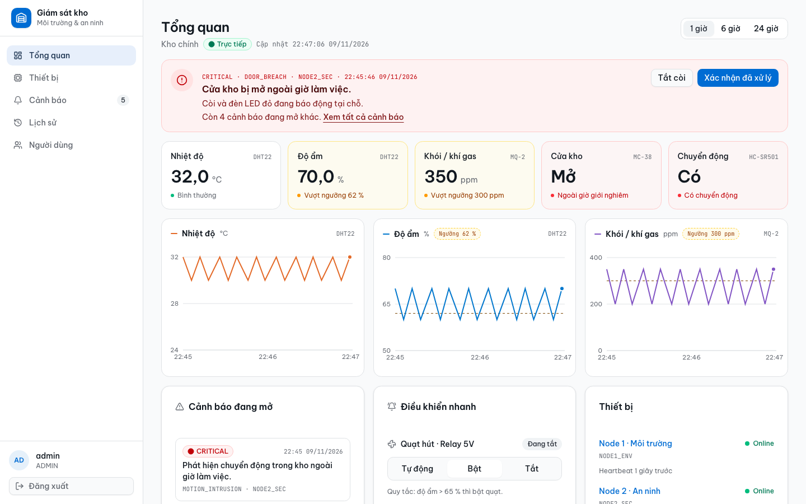
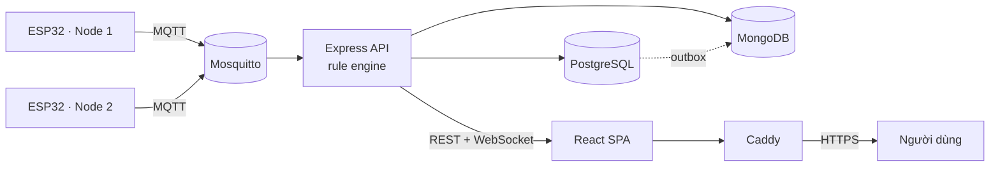
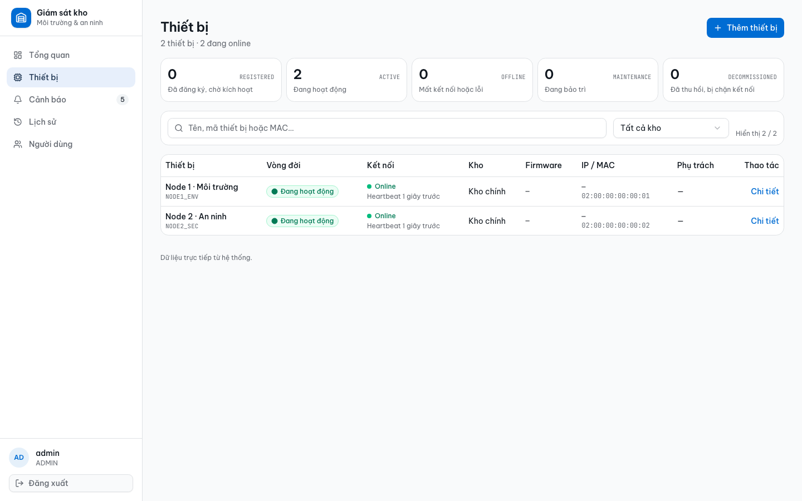
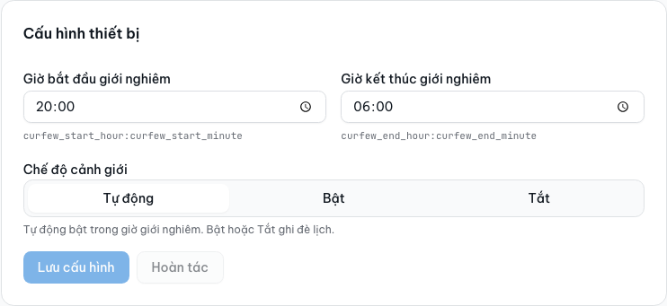
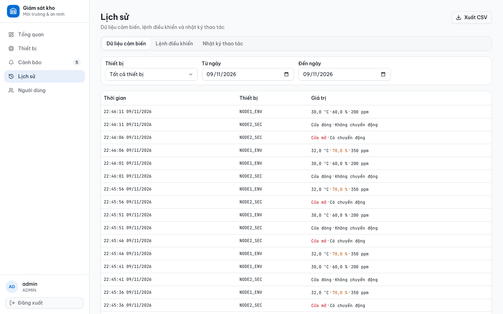
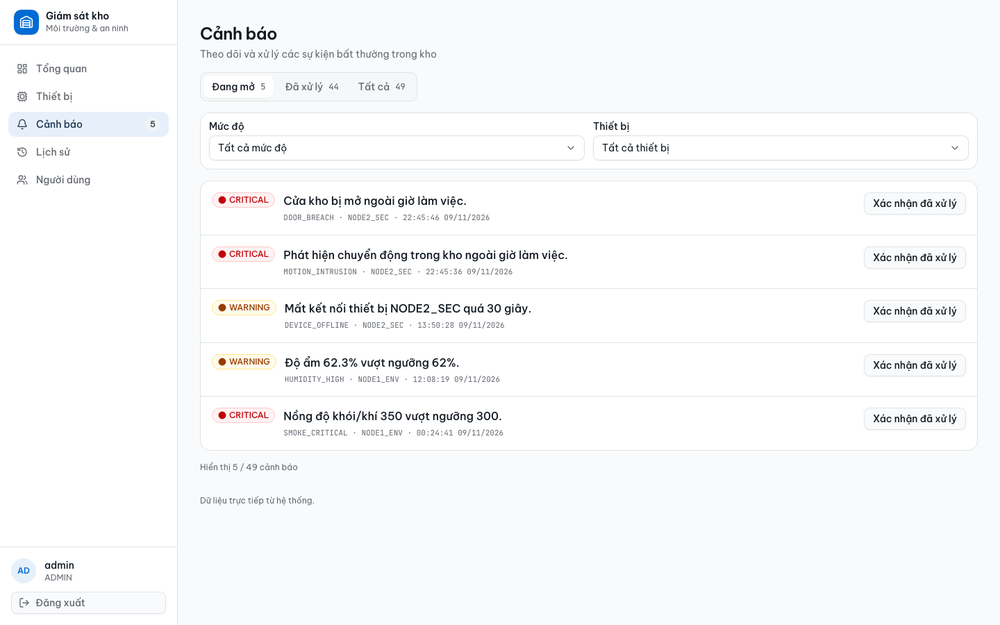
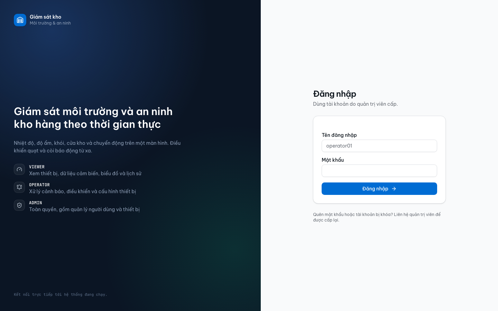
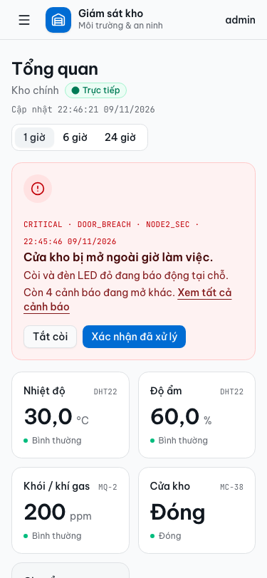

# Hệ thống giám sát môi trường và an ninh kho hàng (IoT)

Dashboard thời gian thực cho kho hàng: theo dõi nhiệt độ, độ ẩm, khói, cửa và chuyển động từ ESP32, điều khiển quạt và còi, cấu hình ngưỡng và giờ giới nghiêm, quản lý thiết bị, người dùng và lịch sử.



## Tính năng

**Giám sát**

- Nhiệt độ, độ ẩm, khói / khí gas, trạng thái cửa và chuyển động theo thời gian thực.
- Biểu đồ 1 / 6 / 24 giờ, gộp theo khoảng thời gian, có dải thấp–cao và đường ngưỡng.
- Phát hiện mất kết nối sau 30 giây; thiết bị tự chuyển `OFFLINE`.
- Cảnh báo `WARNING` / `CRITICAL`, có đếm số cảnh báo đang mở và xác nhận xử lý.

**Điều khiển**

- Quạt: `Tự động`, `Bật`, `Tắt`. Chế độ `AUTO` bật khi độ ẩm vượt ngưỡng.
- Còi báo động: tắt từ xa, trạng thái lấy từ bo nên thao tác tay cũng hiện ngay.
- Cấu hình ngưỡng nhiệt độ, độ ẩm, khói và đẩy xuống thiết bị.
- Node 2: **chế độ cảnh giới** `Tự động / Bật / Tắt` và **giờ giới nghiêm** chọn đến phút.
- Cảnh báo chỉ phát khi cảnh giới đang bật. Ban ngày là `WARNING`, ngoài giờ là `CRITICAL`.

**Quản trị**

- Đăng ký, kích hoạt, bảo trì, thu hồi, kích hoạt lại hoặc xóa thiết bị đã thu hồi; cấp lại token một lần.
- Quản lý tài khoản và ba vai trò `ADMIN`, `OPERATOR`, `VIEWER`.
- Lịch sử dữ liệu cảm biến, lệnh điều khiển và nhật ký thao tác; phân trang, lọc theo ngày và xuất CSV.
- Nhật ký kiểm tra cho mọi thao tác ghi.

**Giao diện**

- Tailwind CSS v4 và shadcn, biểu tượng Lucide.
- Responsive từ 375 px; bảng cuộn trong thẻ, menu dạng sheet trên điện thoại.
- Trạng thái tải, lỗi, rỗng và phân quyền theo vai trò.

## Kiến trúc



- **Thiết bị** gửi telemetry, heartbeat và ACK qua MQTT.
- **Backend** xác thực JWT, chạy rule engine, ghi PostgreSQL, đồng bộ MongoDB qua outbox và phát sự kiện WebSocket.
- **Frontend** đọc REST và nhận sự kiện thời gian thực; không có dữ liệu giả khi chạy `VITE_DATA_SOURCE=api`.
- **Caddy** phục vụ bản build tĩnh, proxy `/api` và nâng cấp `/ws`, tự cấp chứng chỉ TLS.

Chi tiết: [docs/architecture.md](docs/architecture.md).

## Công nghệ

| Lớp | Công nghệ |
| --- | --- |
| Thiết bị | ESP32, DHT22, MQ-2, MC-38, HC-SR501, relay, buzzer, OLED |
| Giao thức | MQTT 3.1.1, REST/JSON, WebSocket |
| Backend | Node.js 22, Express 5, `pg`, Mongoose, `mqtt`, `ws`, JWT |
| Dữ liệu | PostgreSQL 15 (nghiệp vụ), MongoDB 7 (lịch sử) |
| Frontend | React 18, TypeScript, Vite 8, React Router 6, Zustand, Recharts, Tailwind CSS v4, shadcn |
| Hạ tầng | Docker Compose, Caddy, Mosquitto, Oracle Cloud Always Free |

## Cấu trúc thư mục

```text
backend/            Express API, rule engine, MQTT, migrations, test
frontend/           React SPA, shadcn, biểu đồ, store
firmware/           Sketch ESP32 cho Node 1 và Node 2
deployments/        Docker Compose, Caddyfile, Mosquitto, deploy
docs/               Kiến trúc, API, vận hành, ảnh, release notes
scripts/            Kiểm tra commit message
.github/workflows/  CI
```

## Chạy nhanh bằng Docker

Yêu cầu Docker Desktop và Docker Compose.

```sh
cd deployments
cp .env.example .env
# sửa POSTGRES_PASSWORD, MONGO_PASSWORD, JWT_SECRET; đặt SEED_DEFAULT_NODES=true
docker compose --env-file .env up -d --build
docker compose ps
```

Tạo tài khoản và hai node demo:

```sh
docker compose exec \
  -e SEED_ADMIN_PASSWORD='Admin@12345' \
  -e SEED_OPERATOR_PASSWORD='Operator@12345' \
  -e SEED_VIEWER_PASSWORD='Viewer@12345' \
  backend npm run seed
```

Sinh dữ liệu mô phỏng (tuỳ chọn):

```sh
docker exec -d deployments-backend-1 npm run simulate
```

| Dịch vụ | Địa chỉ |
| --- | --- |
| Giao diện | http://localhost:5173 (chạy `npm run dev` trong `frontend`) |
| API | http://localhost:3000/api |
| Health | http://localhost:3000/health |
| WebSocket | `ws://localhost:3000/ws?token=JWT` |
| PostgreSQL | 5432 (127.0.0.1) |
| MongoDB | 27017 (127.0.0.1) |
| Mosquitto | 1883 |

## Chạy phát triển

Yêu cầu Node.js 22.12+.

```sh
# Backend (Postgres, MongoDB, Mosquitto phải đang chạy)
cd backend
npm ci
cp .env.example .env
npm run dev

# Frontend
cd frontend
npm ci
cp .env.example .env
# đặt VITE_DATA_SOURCE=api
npm run dev
```

Kiểm thử:

```sh
cd frontend && npm run lint && npm run build && npm test
cd backend && npm test
```

Frontend có 103 test, backend 26 test. Chi tiết: [docs/development.md](docs/development.md).

## Thiết bị và firmware

Hai sketch nằm trong `firmware/`:

- `node1-environment`: DHT22, MQ-2, relay quạt, nút nhấn tay, OLED.
- `node2-security`: MC-38, HC-SR501, buzzer, LED, chế độ cảnh giới.

Cấu hình tối thiểu trên bo:

```cpp
const char* mqtt_server = "<địa chỉ broker>";
const int mqtt_port = 1883;

// Node 1
client.connect("NODE1_ENV", "node1", "<mật khẩu MQTT>");

// Node 2
client.connect("NODE2_SEC", "node2", "<mật khẩu MQTT>");
```

- Mã thiết bị phải có dạng `NODE<số>_ENV` hoặc `NODE<số>_SEC` và đã được đăng ký, kích hoạt.
- Node 2 nhận `guard_mode on/off` từ backend theo giờ giới nghiêm.
- Backend gửi lại `guard_mode` mỗi heartbeat 30 giây và mỗi lần lưu cấu hình.

Giao kèo MQTT đầy đủ: [docs/architecture.md#mqtt](docs/architecture.md#mqtt).

## Cấu hình

Các biến chính trong `deployments/.env` (hoặc `backend/.env`):

| Biến | Mặc định | Ý nghĩa |
| --- | --- | --- |
| `JWT_SECRET` | bắt buộc | Khoá ký JWT, tối thiểu 32 ký tự |
| `JWT_EXPIRES_IN` | `24h` | Thời hạn phiên |
| `CORS_ORIGIN` | `http://localhost:5173` | Danh sách origin, cách nhau bằng dấu phẩy |
| `MQTT_BROKER_URL` | `mqtt://localhost:1883` | Broker MQTT |
| `MQTT_TOPIC_PREFIX` | `khohang` | Tiền tố topic |
| `OFFLINE_TIMEOUT_SECONDS` | `30` | Thời gian chờ trước khi đánh dấu mất kết nối |
| `COMMAND_TIMEOUT_SECONDS` | `10` | Thời gian chờ ACK của lệnh |
| `NIGHT_TIMEZONE` | `Asia/Ho_Chi_Minh` | Múi giờ tính giới nghiêm |
| `NIGHT_START_HOUR` / `NIGHT_END_HOUR` | `20` / `6` | Cửa sổ mặc định khi thiết bị chưa có giờ riêng |
| `SEED_DEFAULT_NODES` | `false` | Tạo `NODE1_ENV`, `NODE2_SEC` khi seed |

## Ảnh giao diện

| | |
| --- | --- |
|  |  |
|  |  |
|  |  |

## API và WebSocket

REST dùng tiền tố `/api`, xác thực bằng `Authorization: Bearer <JWT>`. WebSocket tại `/ws?token=<JWT>` phát các sự kiện `telemetry`, `device_status`, `alert_created`, `alert_updated`, `command_status`, `actuator_status`.

Danh sách đầy đủ, quyền và ví dụ: [docs/api.md](docs/api.md).

## Triển khai

Một VM Linux chạy toàn bộ stack sau Caddy. Hướng dẫn từng bước, gồm migration, backup và xử lý sự cố: [docs/operations.md](docs/operations.md).

Bản demo hiện tại: <https://158.178.229.252.sslip.io>

## Bảo mật và giới hạn

- JWT 24 giờ; vai trò kiểm tra ở backend, không chỉ ở giao diện.
- PostgreSQL và MongoDB không mở cổng công khai trong bản production.
- Broker production bắt buộc user/password; bản dev để `allow_anonymous true`.
- MQTT đang chạy plaintext trên 1883. Muốn mã hoá cần TLS 8883 và `WiFiClientSecure`.
- Backend chưa kiểm tra token riêng của từng thiết bị trên MQTT; chỉ kiểm tra mã thiết bị và vòng đời. Cần bật ACL theo topic khi triển khai thật.
- `POST /api/auth/login` chưa có giới hạn tần suất.
- Tài khoản seed chỉ dùng cho demo; đổi mật khẩu trước khi mở rộng truy cập.

## Tài liệu

- [Kiến trúc](docs/architecture.md)
- [API](docs/api.md)
- [Phát triển](docs/development.md)
- [Vận hành và triển khai](docs/operations.md)
- [Release v1.0.0](docs/release-notes/v1.0.0.md)
- [Đóng góp](CONTRIBUTING.md)

## Đóng góp

Đọc [CONTRIBUTING.md](CONTRIBUTING.md). Không thêm dòng `Co-Authored-By` cho công cụ AI; CI sẽ từ chối.
