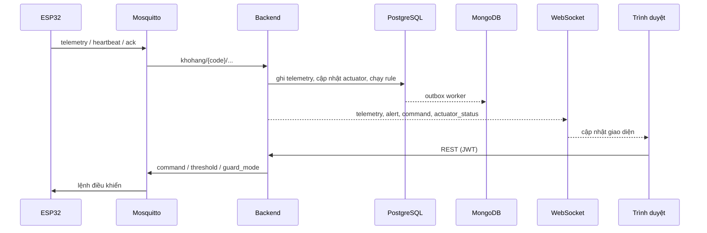

# Kiến trúc

Tài liệu này mô tả các thành phần, luồng dữ liệu và giao kèo giữa thiết bị, backend và giao diện.

## Thành phần

| Thành phần | Vai trò |
| --- | --- |
| ESP32 Node 1 | Đọc DHT22, MQ-2; điều khiển relay quạt; nút nhấn tay; OLED |
| ESP32 Node 2 | Đọc MC-38, HC-SR501; điều khiển buzzer và LED; chế độ cảnh giới |
| Mosquitto | Broker MQTT giữa thiết bị và backend |
| Backend | Express 5: REST, WebSocket, rule engine, watchdog, đồng bộ MongoDB |
| PostgreSQL | Nguồn sự thật cho tài khoản, thiết bị, cấu hình, lệnh, cảnh báo, audit và telemetry gần nhất |
| MongoDB | Lưu lịch sử telemetry và cảnh báo để truy vấn theo thời gian |
| Frontend | React SPA: dashboard, điều khiển, quản trị |
| Caddy | TLS, phục vụ bản build tĩnh, proxy `/api` và `/ws` |

## Luồng dữ liệu



## MQTT

Tiền tố mặc định là `khohang`. Mỗi thiết bị có mã dạng `NODE<số>_ENV` hoặc `NODE<số>_SEC`.

| Topic | Chiều | Payload |
| --- | --- | --- |
| `khohang/{code}/telemetry` | Thiết bị → Backend | Xem bảng bên dưới |
| `khohang/{code}/ack` | Thiết bị → Backend | `{ "device_id", "command_id"?, "status" }` |
| `khohang/{code}/heartbeat` | Thiết bị → Backend | `{ "device_id", "status": "online" }` |
| `khohang/heartbeat` | Thiết bị → Backend | `{ "device_id": "NODE1_ENV", "status": "online" }` |
| `khohang/{code}/command` | Backend → Thiết bị | Lệnh, ngưỡng hoặc `guard_mode` |

Telemetry Node 1:

```json
{ "device_id": "NODE1_ENV", "temperature": 32.3, "humidity": 62.1, "smoke_level": 300 }
```

Telemetry Node 2:

```json
{
  "device_id": "NODE2_SEC",
  "door_open": 1,
  "motion_detected": 0,
  "alarm_state": "OFF",
  "guard_mode": "ON",
  "alarm_duration": 30
}
```

Backend chấp nhận cả `smoke_level` và `smoke_gas_level`, `door_open` và `door_status`. Thời điểm ghi nhận là lúc backend nhận bản tin.

Lệnh:

```json
{ "command_id": 12, "fan": "on" }
{ "command_id": 13, "alarm": "off" }
{ "threshold_t": 50, "threshold_h": 65, "threshold_gas": 300 }
{ "guard_mode": "on" }
```

ACK hợp lệ: `FAN_ON_ACK`, `FAN_OFF_ACK`, `ALARM_ON_ACK`, `ALARM_OFF_ACK`, `ACKNOWLEDGED`, `FAILED`. ACK không có `command_id` vẫn cập nhật trạng thái actuator, nên thao tác tay trên bo hiện ngay trên dashboard.

## Rule engine

Backend chạy rule trên mỗi bản tin telemetry, dùng bản ghi trước đó để phát hiện chuyển trạng thái.

### Node môi trường

| Điều kiện | Kết quả |
| --- | --- |
| Khói hoặc nhiệt độ vượt ngưỡng | Cảnh báo `SMOKE_CRITICAL` / `TEMPERATURE_CRITICAL`, gửi `FAN_OFF` và `BUZZER_ON` |
| Độ ẩm vượt ngưỡng | Cảnh báo `HUMIDITY_HIGH` (WARNING) |
| Quạt `AUTO` và độ ẩm đổi phía so với ngưỡng | Gửi `FAN_ON` hoặc `FAN_OFF` |
| Quạt `ON` / `OFF` | Rule không ghi đè chế độ thủ công |

### Node an ninh

| Điều kiện | Kết quả |
| --- | --- |
| Cảnh giới `OFF` | Không cảnh báo |
| Cảnh giới `ON` | Cảnh báo mọi lúc |
| Cảnh giới `AUTO` | Chỉ cảnh báo trong giờ giới nghiêm của thiết bị |
| Cửa mở hoặc có chuyển động (sườn lên) | `DOOR_BREACH` / `MOTION_INTRUSION` |
| Ban ngày | `WARNING`, nội dung "trong giờ làm việc" |
| Ngoài giờ | `CRITICAL`, nội dung "ngoài giờ làm việc", gửi `BUZZER_ON` |

Giờ giới nghiêm lưu theo từng thiết bị: `curfew_start_hour`, `curfew_start_minute`, `curfew_end_hour`, `curfew_end_minute`, mặc định 20:00–06:00. `NIGHT_*` trong `.env` chỉ là mặc định.

Cảnh báo trùng được chặn bằng unique index `(device_id, alert_type)` cho các cảnh báo chưa xác nhận.

## Watchdog

| Việc | Chu kỳ | Ngưỡng |
| --- | --- | --- |
| Thiết bị mất kết nối | 1 giây | `OFFLINE_TIMEOUT_SECONDS`, mặc định 30 |
| Lệnh không có ACK | 1 giây | `COMMAND_TIMEOUT_SECONDS`, mặc định 10 |

Thiết bị `ACTIVE` không có heartbeat trong ngưỡng sẽ chuyển `OFFLINE` và tạo cảnh báo `DEVICE_OFFLINE`.

## Mô hình dữ liệu

### PostgreSQL

| Bảng | Nội dung |
| --- | --- |
| `users` | Tài khoản, hash mật khẩu, vai trò, trạng thái |
| `warehouses` | Kho |
| `nodes` | Thiết bị, mã, MAC, vòng đời, heartbeat, hash token |
| `sensors`, `actuators` | Cảm biến và cơ cấu chấp hành của từng node |
| `device_configs` | Ngưỡng, giờ giới nghiêm, chế độ cảnh giới, chế độ quạt |
| `telemetry` | Bản ghi cảm biến gần nhất |
| `alerts` | Cảnh báo và trạng thái xử lý |
| `device_controls` | Lệnh điều khiển và trạng thái |
| `audit_logs` | Nhật ký thao tác |
| `mongo_outbox` | Hàng đợi đồng bộ sang MongoDB |
| `alert_rules` | Khung cho rule cấu hình được (chưa dùng trong UI) |

### MongoDB

Database `warehouse_history`:

- `telemetries`: cùng trường với bảng `telemetry`, thêm bản ghi lịch sử.
- `alerts`: cùng trường với bảng `alerts`.

Ghi vào PostgreSQL và `mongo_outbox` trong cùng transaction. Worker đẩy sang MongoDB bằng upsert theo ID, thử lại với backoff tối đa 60 giây. Đây là đồng bộ cuối cùng nhất quán, không phải transaction phân tán.

## Realtime

WebSocket `/ws?token=<JWT>` phát:

| Sự kiện | Dữ liệu | Tác dụng |
| --- | --- | --- |
| `telemetry` | Bản ghi telemetry | Thêm vào dashboard và biểu đồ |
| `device_status` | `{device_id, online, last_heartbeat, lifecycle_status}` | Cập nhật badge online |
| `alert_created` | Alert | Thêm cảnh báo, hiện banner |
| `alert_updated` | Alert | Cập nhật trạng thái xử lý |
| `command_status` | Lệnh | Cập nhật trạng thái lệnh |
| `actuator_status` | `{device_id, actuator_type, state}` | Cập nhật quạt / còi theo bo |

Client tự kết nối lại với backoff 1 / 2 / 4 / 10 giây và tải lại dashboard sau khi kết nối lại.

## Bảo mật

- JWT 24 giờ; backend kiểm tra vai trò trên từng route ghi.
- Token thiết bị chỉ dùng cho quy trình đăng ký / cấp lại; MQTT chưa xác thực theo token.
- Production: Mosquitto bắt buộc user/password; PostgreSQL và MongoDB chỉ nghe nội bộ.
- MQTT 1883 hiện là plaintext. TLS 8883 cần `WiFiClientSecure` trên firmware.
- Chưa có giới hạn tần suất đăng nhập.
- Nên bật ACL topic theo từng thiết bị khi triển khai ngoài phạm vi demo.
